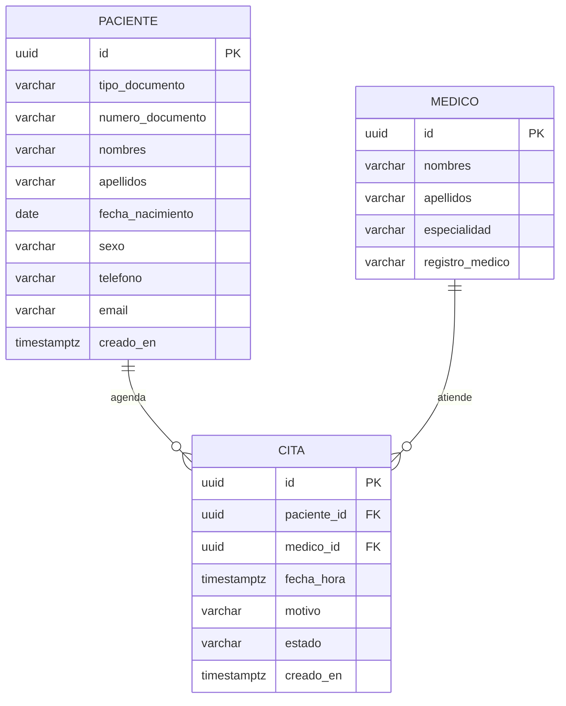

# Modelo de datos

## hce-service

## Decisiones

**Registro único de paciente.** El par (tipo_documento, numero_documento) es
único. Recepción busca al paciente por documento antes de registrarlo, así que
sus datos se capturan una sola vez y el resto de módulos usa su `id`.

**Identificadores UUID.** Un id secuencial permite adivinar otras historias
cambiando el número en la URL. Con UUID eso no es posible.

**Esquema versionado con Flyway.** Hibernate solo valida (`ddl-auto: validate`).
Todo cambio al esquema entra como un script `V{n}__descripcion.sql`, de modo
que local y producción siempre tienen la misma estructura.

**Sexo con códigos H / M / I**, la misma codificación de RIPS.

**Un médico, una cita por horario.** Un índice único parcial sobre
(medico_id, fecha_hora) ignora las citas canceladas. Cancelar libera el
horario sin borrar el registro.

**Estados de la cita.** PROGRAMADA → ATENDIDA cuando el médico registra la
consulta, o PROGRAMADA → CANCELADA. Una cita atendida o cancelada no cambia más.

**Horas en UTC.** `fecha_hora` se guarda como TIMESTAMPTZ y la API la devuelve
en hora de Colombia (America/Bogota).

**Médicos de demostración.** Se cargan en la migración V2. La administración
de médicos queda fuera del alcance.