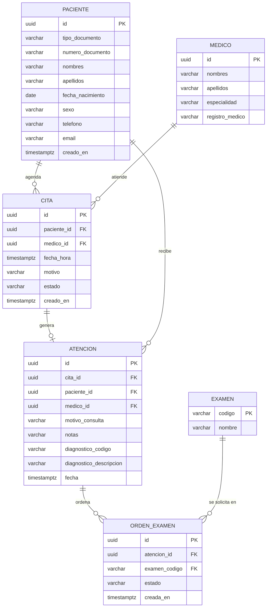
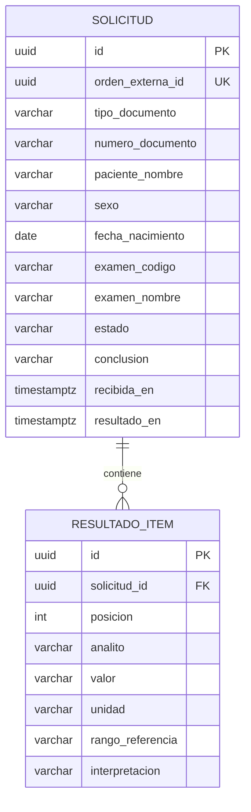

# Modelo de datos

## hce-service

## Decisiones

**Registro único de paciente.** El par (tipo_documento, numero_documento) es
único. Recepción busca al paciente por documento antes de registrarlo, así que
sus datos se capturan una sola vez y el resto de módulos usa su `id`.

**Identificadores UUID.** Un id secuencial permite adivinar otras historias
cambiando el número en la URL. Con UUID eso no es posible.

**Esquema versionado con Flyway.** Hibernate solo valida (`ddl-auto: validate`).
Todo cambio al esquema entra como un script `V{n}__descripcion.sql`, de modo
que local y producción siempre tienen la misma estructura.

**Sexo con códigos H / M / I**, la misma codificación de RIPS.

**Un médico, una cita por horario.** Un índice único parcial sobre
(medico_id, fecha_hora) ignora las citas canceladas. Cancelar libera el
horario sin borrar el registro.

**Estados de la cita.** PROGRAMADA → ATENDIDA cuando el médico registra la
consulta, o PROGRAMADA → CANCELADA. Una cita atendida o cancelada no cambia más.

**Horas en UTC.** `fecha_hora` se guarda como TIMESTAMPTZ y la API la devuelve
en hora de Colombia (America/Bogota).

**Médicos de demostración.** Se cargan en la migración V2. La administración
de médicos queda fuera del alcance.

**La atención cierra la cita.** Registrar la atención, pasar la cita a
ATENDIDA y crear las órdenes ocurre en una sola transacción. Si un examen no
existe, no se guarda nada y la cita sigue PROGRAMADA.

**Codificación estándar.** Diagnósticos en CIE-10 (4 caracteres) y exámenes
en CUPS. Con códigos estándar, otro sistema entiende la información sin
traducciones manuales.

**Estados de la orden.** CREADA → ENVIADA (laboratorio la recibió) →
COMPLETADA (llegó el resultado).

## lab-service

### Decisiones

**Base de datos propia.** Laboratorio no lee las tablas de la HCE ni la HCE las
de laboratorio. Todo intercambio pasa por la API.

**Solo los datos necesarios.** Laboratorio recibe identificación, sexo y fecha
de nacimiento (los rangos de referencia dependen de ellos) y el examen pedido.
No recibe diagnósticos, notas clínicas ni el resto de la historia.

**Recepción idempotente.** `orden_externa_id` es único. Si la misma orden llega
dos veces, se devuelve la solicitud existente en vez de crear otra. Esto permite
reintentar envíos sin duplicar exámenes.

**Resultados inmutables.** Una vez registrado, un resultado no se modifica. Las
correcciones (en FHIR, `status = amended`) quedan fuera del alcance.

**Interpretación con códigos HL7** (N normal, H alto, L bajo, A anormal), los
mismos de `Observation.interpretation` en FHIR.