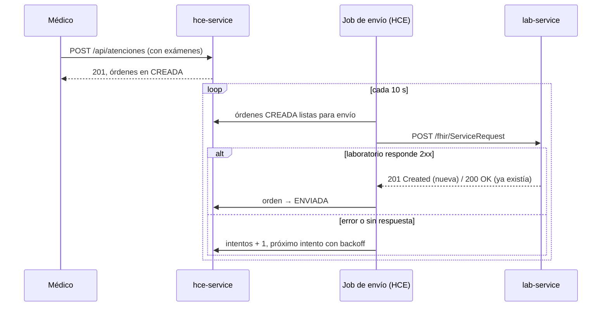
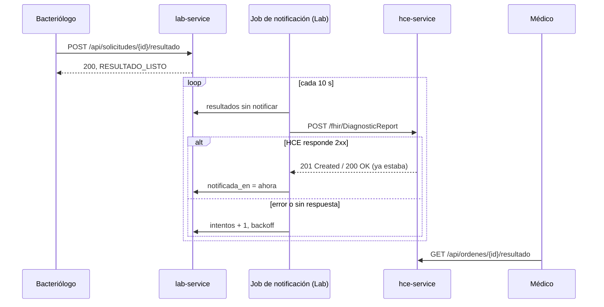

# Integración HCE ↔ Laboratorio

## Envío de órdenes

## Decisiones

**Envío asíncrono.** Registrar la atención no llama al laboratorio. Si
laboratorio está caído, el médico cierra la consulta igual y la orden se
envía cuando vuelva.

**La orden es su propia cola de salida.** La orden se guarda en la misma
transacción que la atención. No existe el caso "se creó la orden pero se
perdió el envío": mientras esté en CREADA, el job la sigue intentando.

**Reintentos con backoff exponencial.** 10 s, 20 s, 40 s, 80 s, 160 s y luego
cada 5 minutos. Cada orden guarda sus intentos y el último error.

**Al menos una vez + idempotencia.** La HCE puede enviar una orden más de una
vez (por ejemplo, si se corta la conexión después de que laboratorio la
guardó). Laboratorio identifica la orden por su id y no la duplica.

**Timeouts.** Conexión 3 s, lectura 5 s. Un laboratorio colgado no bloquea
el envío de las demás órdenes indefinidamente.

**Errores.** Laboratorio responde los errores como Problem Details (RFC 9457)
y no como `OperationOutcome` de FHIR. Es una simplificación del alcance.

## Retorno de resultados

**El resultado puede llegar antes que la confirmación del envío.** Si la
respuesta de laboratorio a un ServiceRequest se perdió, la orden sigue en
CREADA en la HCE aunque laboratorio ya la procesó. La HCE acepta el
resultado igual y pasa la orden directo a COMPLETADA.

**Recepción idempotente en la HCE.** Si llega un resultado para una orden
ya COMPLETADA, responde 200 sin modificar nada.