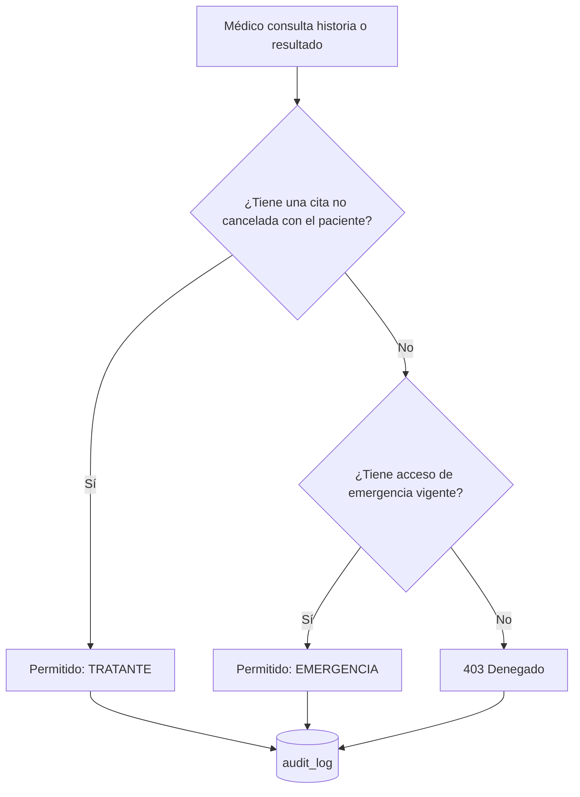

# Seguridad y acceso a la información

## Respuesta al debate

No toda la información del paciente debe estar disponible para todos los
empleados. Cada rol accede solo a lo que necesita (mínimo privilegio), el
paciente es el titular de su historia clínica (Ley 2015 de 2020; Ley 1581 de
2012) y todo acceso a información clínica queda registrado.

## Autenticación

- Login en `POST /api/auth/login`. JWT firmado con HS256, válido por 8 horas.
- Contraseñas con BCrypt. Usuario inexistente y contraseña errada responden
  igual y tardan lo mismo.
- Se valida firma, expiración y emisor (`saluddigital-hce`). La clave viene
  de `JWT_SECRET` (mínimo 256 bits), sin valor por defecto.

## Matriz de acceso

| Endpoint                           | Recepción | Médico | Gerencia | Auditor |
|------------------------------------|:---------:|:------:|:--------:|:-------:|
| Registrar paciente                 | ✔         |        |          |         |
| Buscar / ver paciente (demografía) | ✔         | ✔      |          |         |
| Agendar / cancelar cita            | ✔         |        |          |         |
| Ver citas y agendas                | ✔         | ✔      |          |         |
| Registrar atención y órdenes       |           | ✔ (1)  |          |         |
| Ver historia clínica               |           | ✔ (2)  |          |         |
| Ver resultados de laboratorio      |           | ✔ (2)  |          |         |
| Activar acceso de emergencia       |           | ✔      |          |         |
| Indicadores agregados              |           |        | ✔        |         |
| Auditoría y revisión de emergencias|           |        |          | ✔       |

(1) Solo el médico asignado a la cita.
(2) Solo con relación de atención o acceso de emergencia vigente.

Todo endpoint que no aparece en la matriz se deniega por defecto.

## Médico tratante y acceso de emergencia

- Una cita PROGRAMADA ya cuenta: el médico necesita la historia antes de la
  consulta.
- El acceso de emergencia exige una justificación de al menos 20 caracteres,
  dura 4 horas y queda pendiente hasta que el auditor lo revisa.

## Auditoría

- Se registra toda consulta de historia, atención y resultado, permitida o
  denegada, con usuario, rol, paciente, recurso, decisión y fecha.
- El registro se guarda en una transacción propia (`REQUIRES_NEW`). Así un
  intento denegado queda registrado aunque la petición termine en error.
- `audit_log` es de solo inserción: triggers de PostgreSQL rechazan
  `UPDATE`, `DELETE` y `TRUNCATE`, y la entidad es `@Immutable`.
- Limitación: un superusuario de la base de datos puede desactivar los
  triggers. En producción, la aplicación se conectaría con un usuario sin
  esos privilegios.

## Indicadores para gerencia

Gerencia no accede a ningún dato individual. Recibe solo conteos y promedios:
pacientes, citas por estado, atenciones, órdenes, tiempo de entrega de
resultados y diagnósticos frecuentes.

Los diagnósticos con menos de 5 casos se agrupan en "Otros". Un grupo muy
pequeño podría permitir identificar a una persona (por ejemplo, el único caso
de una enfermedad rara en el mes).

## Usuarios de demostración

`recepcion`, `dr.gomez`, `dra.diaz`, `gerencia` y `auditor`, con la
contraseña `SaludDigital2026`.

## Pendiente

- Autenticación entre servicios para `/fhir/**` (6c).
- Que el paciente consulte quién accedió a su historia (requiere la app de
  pacientes).